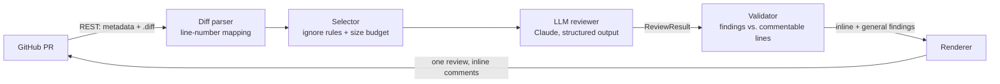

# ai-code-review-agent

[](https://github.com/Sunil994923/ai-code-review-agent/actions/workflows/ci.yml)


An LLM-powered pull request reviewer. It reads a PR diff, asks Claude for a review in a **strict, typed JSON schema**, checks every finding against the lines that actually changed, and posts a single GitHub review with inline comments.

It runs as a **GitHub Action** on every pull request, or as a **CLI** against any local `git diff`.

## Why it's built this way

Most "AI reviewer" scripts paste a diff into a chat prompt and post whatever text comes back. That breaks in practice:

| Problem | How this project handles it |
|---|---|
| Free-form output is hard to parse | Structured outputs: the response is checked against a Pydantic `ReviewResult` schema |
| The model comments on lines that aren't in the diff, so GitHub rejects the review | Every diff line is tagged with its new-file line number, and findings off the diff move to the summary instead of failing the request |
| Lock files and generated code waste tokens | Ignore patterns, plus a prompt-size budget. Skipped files are listed in the summary, never silently cut |
| A PR description can contain prompt injection | PR content is wrapped in tags and the system prompt treats it as data |
| Noisy output | Severity threshold (`--min-severity`), sorted by severity, one review per PR (one notification) |
| Refusals or truncated output | `stop_reason` is checked before reading results; server-side model fallback is enabled |

## Architecture



```
src/code_review_agent/
├── diff.py      unified-diff parser, commentable-line map, file selection
├── llm.py       Claude call with structured output, refusal / truncation handling
├── models.py    Finding / ReviewResult schema (shared contract)
├── review.py    validation against the diff, Markdown rendering
├── github.py    GitHub REST client (read PR, publish review)
└── cli.py       `pr` and `diff` commands
```

## Use it as a GitHub Action

1. Add an `ANTHROPIC_API_KEY` secret to the repository (Settings → Secrets and variables → Actions).
2. Add `.github/workflows/ai-review.yml`:

```yaml
name: AI review
on:
  pull_request:
    types: [opened, synchronize, reopened]

permissions:
  contents: read
  pull-requests: write

jobs:
  review:
    runs-on: ubuntu-latest
    steps:
      - uses: Sunil994923/ai-code-review-agent@main
        with:
          anthropic-api-key: ${{ secrets.ANTHROPIC_API_KEY }}
          min-severity: medium
```

## Use it from the command line

```bash
python -m venv .venv && source .venv/bin/activate      # Windows: .venv\Scripts\activate
pip install -e ".[dev]"
export ANTHROPIC_API_KEY=...                            # or use an `ant auth login` profile

# Review local changes
git diff main | code-review-agent diff -

# Review a GitHub PR without posting (dry run)
export GITHUB_TOKEN=...
code-review-agent pr --repo owner/name --pr 42 --dry-run
```

| Option / env var | Default | Description |
|---|---|---|
| `--model` / `REVIEW_MODEL` | `claude-opus-5-5` | Claude model id |
| `--effort` / `REVIEW_EFFORT` | `high` | Reasoning effort: `low` … `max` |
| `--min-severity` / `REVIEW_MIN_SEVERITY` | `low` | Drop findings below this severity |

## Example output

For the diff in [`tests/fixtures/sample.diff`](tests/fixtures/sample.diff), which builds a SQL query with string formatting, an inline comment looks like this:

> 🔴 **CRITICAL · security** — SQL injection via string-formatted query
>
> `customer.id` is interpolated directly into the SQL string. If it can be influenced by a caller, an attacker can read or modify other customers' card data.
>
> **Suggestion:** `db.execute("SELECT * FROM cards WHERE customer_id = %s", (customer.id,))`

*(This is the format the renderer produces. The wording of real findings comes from the model and varies per run.)*

## Tests

```bash
pytest          # 18 tests, no network or API key needed
ruff check .
```

The tests replace the Claude client and GitHub with fakes (`httpx.MockTransport`), so CI is fast, free and deterministic. They cover diff parsing and line mapping, file selection, validating findings against the diff, rendering, refusal and truncation handling, and the GitHub request payloads.

## Limitations and next steps

- Very large PRs are reviewed only up to the size budget. Next step: review file by file in parallel, then merge the results.
- No memory across PRs. Next step: add repository conventions (for example `CONTRIBUTING.md`) to a cached system prompt.
- Evaluation: build a small labelled set of diffs with known bugs and measure recall and precision across models and effort levels.

## License

[MIT](LICENSE)
